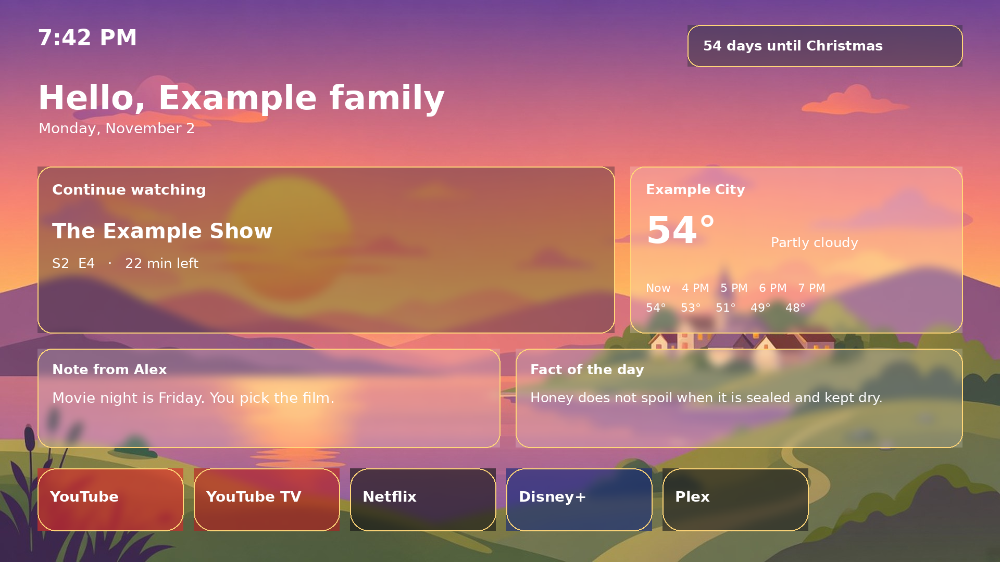
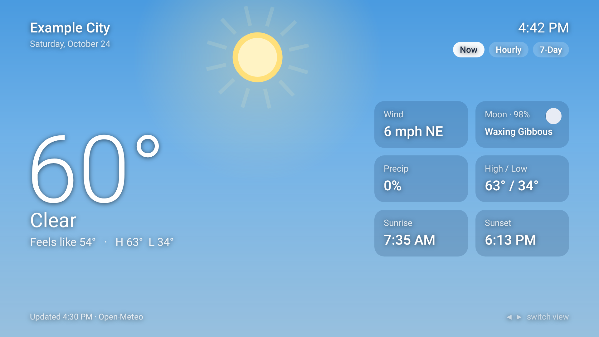
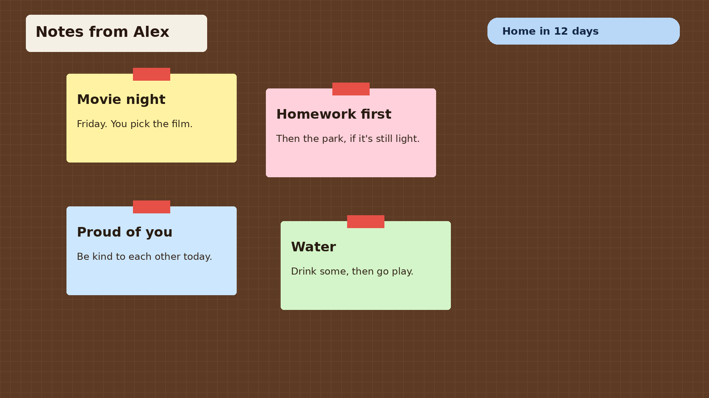
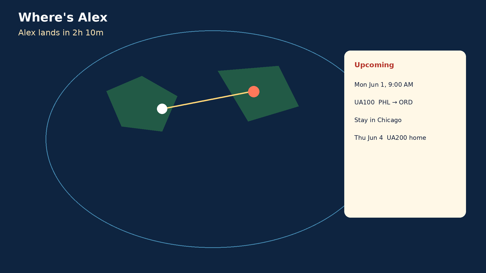
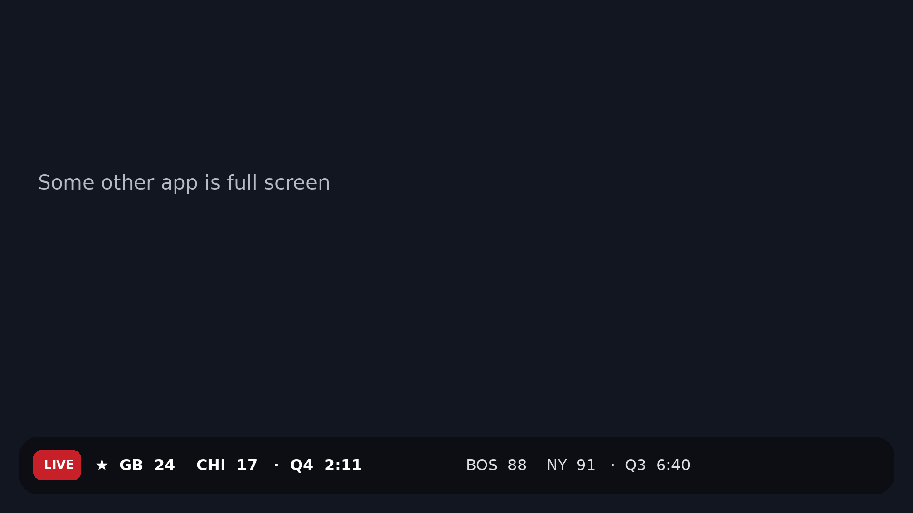

# Family Home

A reproducible Google TV setup: a custom home screen, a weather app, parent notes, a travel tracker, and a sports score ticker. One config file holds the family name, home location, units, clock, ntfy topic, favorite teams, and which apps sit on the top row.

The home screen is a fork of [Luma TV](https://github.com/0xProbabillity/luma-tv) **v2.4** (MIT, Copyright 2026 0xProbability). Package id `app.familytv.launcher`. The upstream project is credited in Settings → About. This build does not show upstream tip addresses.





The weather app renders above are from the instrumented preview test, using the example city. More states (night, rain, snow, hourly, 7-day) are in `docs/screenshots/`.

## What you get

- **Home screen.** Greeting, glass widget cards (dark tint, light frosted, or automatic), a wide Continue watching card, weather, a note, and a fact. D-pad down opens an A–Z All apps grid. A top row of apps and a hidden-app list come from config.
- **Live weather wallpaper.** Illustrated scenes by condition and time of day (day, dusk, night), with rain, snow, and wind overlays. A CC0 photo set is optional. From November 25 the Christmas countdown badge appears, and December 1–26 uses holiday art when Holiday mode is Auto.
- **Weather app** (`app.familytv.weather`). Now, hourly, and 7-day, with a sky that follows the time of day. The weather card opens it.
- **Notes** (`app.familytv.notes`). A corkboard of the last 50 notes. The phone posts to ntfy; the TV shows a popup for about 20 seconds. Kids send stickers back on `<topic>-replies`.
- **Travel** (`app.familytv.where`). A world map, a traveler along the trip, stays, and a home celebration. Optional corner chip. Santa mode in December.
- **Score ticker** (`app.familytv.ticker`). A bottom overlay. Live games first, with a LIVE tag. Favorite teams get a star. A score banner plays a short original sound. NFL and NBA from the public ESPN scoreboard. Logos are downloaded at runtime and are not bundled. Family Home is not affiliated with ESPN, the NFL, or the NBA.
- **Fact of the day.** Offline packs in `launcher/res/raw/facts_general.txt` and `facts_space.txt`. Set `launcher.factPack` to switch. Add `facts_NAME.txt` for another pack. No trademarked fiction is included.
- **TCL debloat** with restore. See [debloat/README.md](debloat/README.md).







## Requirements

- A Google TV or Android TV device, Android 8 or newer (the apps target SDK 34, min SDK 26). Tested against TCL Google TV.
- A computer with JDK 17 or newer, Python 3, and `adb`.
- Android SDK platform 34 and build-tools 36. The launcher build looks at `$ANDROID_SDK_ROOT` or `$HOME/android-sdk`.
- Network access for Open-Meteo, ntfy, and (for the ticker) ESPN. No API keys.

## Configure

```bash
python3 scripts/configure.sh
```

That copies `config/family.example.json` to `config/family.json` (gitignored) and fills a random ntfy topic when the topic is blank. Edit `config/family.json` before you build:

| Field | Meaning |
|---|---|
| `family.name` | Greeting and the Christmas line. Example: `Example family`. |
| `parent.name` | "Notes from Alex", "Where's Alex". |
| `home.name`, `latitude`, `longitude`, `timezone` | Weather, wallpaper, and sunrise. The example is Example City at 39.9526, -75.1652, `America/New_York`. |
| `home.airport` | Home pin for trips. Example: `PHL`. |
| `home.units` | `fahrenheit` (default) or `celsius`. Each app can still switch. |
| `home.clock` | `12` (default) or `24`. Each app can still switch. |
| `ntfy.server` | Default `https://ntfy.sh`. |
| `ntfy.topic` | Generated by `configure.sh`. Blank means each app invents its own on first launch, so generate one and rebuild. |
| `ntfy.token` | Optional bearer token. |
| `photos.enabled`, `photos.albumUrl` | Google Photos frames. **Off.** |
| `flights.enabled` | FlightAware page lookup. **Off.** |
| `ticker.leagues` | `BOTH`, `NFL`, or `NBA`. |
| `ticker.favorites` | `[]`, or codes such as `["NFL:GB","NBA:BOS"]`. Nothing is favorited until you set this or pick teams on the TV. |
| `launcher.topRowApps` | Package names for the top row. |
| `launcher.hiddenApps` | Filtered out of the row and the All apps grid. Not disabled. |
| `launcher.factPack` | `general` or `space`. |
| `launcher.seasonal` | Christmas countdown and art. |
| `tv.address` | `adb` host:port. The example `192.0.2.10:5555` is a documentation placeholder. |

The example names (Example family, Alex, Sam, Riley, Example City) are placeholders.

## Build

```bash
bash scripts/build-all.sh
```

That configures, writes the original UI sounds, builds the launcher, and builds the four Gradle apps.

Launcher only:

```bash
bash launcher/build.sh
# dist/family-home.apk
```

The first launcher build creates `.signing/local.keystore` (password `android`, alias `family-home`). It is gitignored. Set `FAMILY_KEYSTORE` to use another key.

Gradle apps (debug keystore):

```bash
echo "sdk.dir=$ANDROID_SDK_ROOT" > local.properties
./gradlew assembleDebug
```

## Install

Turn on network debugging on the TV, then:

```bash
bash scripts/install.sh 192.0.2.10:5555
launcher/family-home.sh -s 192.0.2.10:5555 home
launcher/family-home.sh -s 192.0.2.10:5555 widgets
```

Replace the address with the TV. `home` sets Family Home as the launcher and, only if the stock Google TV launcher still wins, disables that stock launcher. `restore` turns it back on. `widgets` grants Continue watching and notification access for Now Playing.

```bash
adb install -r launcher/dist/family-home.apk
adb install -r weather/app/build/outputs/apk/debug/weather-debug.apk
adb install -r notes/app/build/outputs/apk/debug/notes-debug.apk
adb install -r where/app/build/outputs/apk/debug/where-debug.apk
adb install -r ticker/app/build/outputs/apk/debug/ticker-debug.apk
adb shell appops set app.familytv.notes SYSTEM_ALERT_WINDOW allow
adb shell appops set app.familytv.where SYSTEM_ALERT_WINDOW allow
adb shell appops set app.familytv.ticker SYSTEM_ALERT_WINDOW allow
```

Open Notes, Travel, and Score Ticker once. They start on boot after that.

Score ticker broadcasts: `app.familytv.ticker.TOGGLE`, `SET_MODE`, `SET_TEAMS`, `SET_ALERTS`.

## Phone

Notes go phone → ntfy → TV. Replies go back to `<topic>-replies`. Travel commands go to `<topic>-where`. Steps for the ntfy app and an iOS Shortcut are in [docs/phone.md](docs/phone.md).

## Debloat

`debloat/debloat.sh` disables a short TCL list with `pm disable-user` and can restore it. It asks you to type YES. Read [debloat/README.md](debloat/README.md) first. Do not disable the stock launcher until Family Home is already the home screen. Do not disable packages marked `keep`.

## Optional lookups

**Google Photos** and **FlightAware** scraping are off. Both read undocumented public pages. Enabling them may conflict with those services' terms. Family Home is not affiliated with Google or FlightAware. Turn photos on in the notes settings, or flights in the travel settings, only after you have read those terms. A shared album link lets anyone with the link see the photos.

Schedule-based trips (`/trip`, `/flight`, `/where`) work with the lookup off. They use the times you send.

## Checks

```bash
python3 scripts/check_personal_data.py
```

The script fails if strings from the private setup that this repo was cleaned from show up in the tree. The needles live only inside that script, split so the secrets are not stored in one piece.

## Credits

- **Luma TV** by 0xProbability, MIT. https://github.com/0xProbabillity/luma-tv tag v2.4, commit `8ce68387cb690786445ffde8d1d1776d07fb6997`. Launcher changes on top of that tag: glass cards, one-page widgets, live weather wallpaper, note and fact cards, all-apps grid, configurable top row and hidden apps. Upstream license: `launcher/LICENSE`.
- **Wallpapers.** Photo set: CC0, listed in `launcher/WALLPAPER_CREDITS.txt`. Illustrated live-weather and holiday art: original generated images for this project.
- **Launcher earcons** `soft_step.wav` and `soft_open.wav`: original sounds from upstream Luma (`launcher/tools/generate_sounds.py`).
- **Notes and ticker sounds:** original synthesized tones from `scripts/make_sounds.py`, CC0. The cheer is a chord, not a stadium recording.
- **Fonts.** Patrick Hand and Caveat, SIL Open Font License (`notes/OFL-*.txt`). Permanent Marker, Apache-2.0 (`notes/LICENSE-PermanentMarker.txt`). Bangers, SIL Open Font License (`ticker/OFL-Bangers.txt`).
- **Santa route fixture:** Apache-2.0, Copyright Google LLC. See `where/SANTA_NOTES.md`.
- **Land outline** in the travel app is a simplified coastline for the map.
- **Weather data:** [Open-Meteo](https://open-meteo.com/).
- **Scores:** ESPN's public scoreboard API. Logos are not bundled.

## Layout

```
config/family.example.json   household config
launcher/                    Family Home (Luma TV fork)
notes/  weather/  where/  ticker/
debloat/                     TCL disable and restore
docs/phone.md                ntfy and iOS Shortcut
scripts/                     configure, build, install, checks
```
